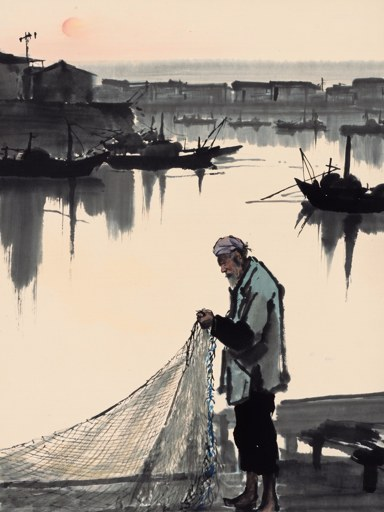
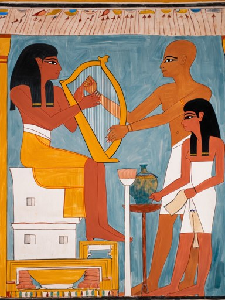
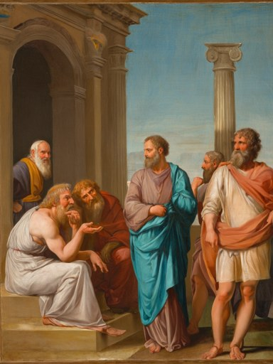
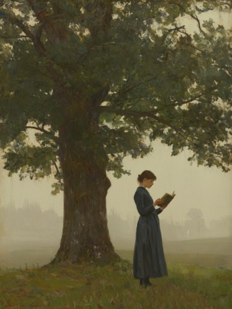
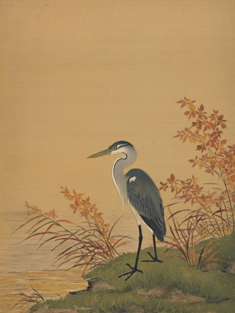
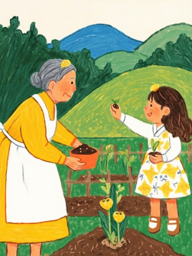
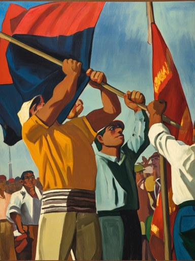
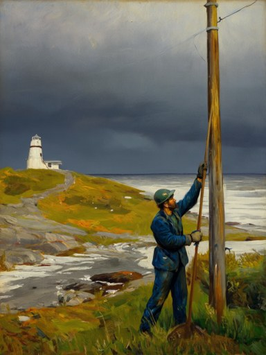
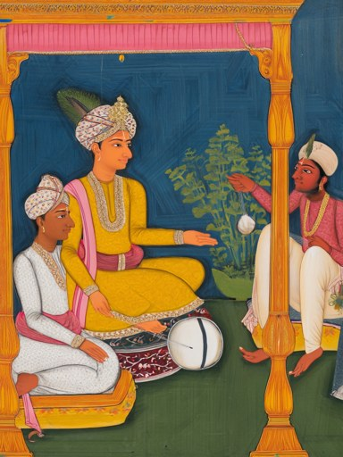
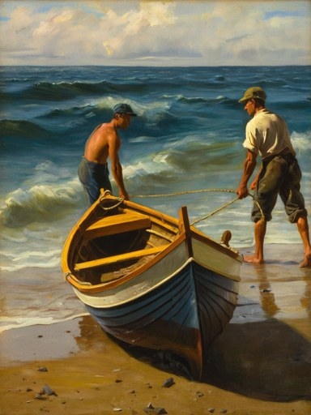

# XenArt LoRA v1.4 (Z-Image Base)

A style LoRA for **Z-Image (Tongyi-MAI/Z-Image, non-distilled base)** that pushes outputs toward
**hand-painted museum-style pictures in 11 style lanes** and away from photographic rendering.
It was trained only on public-domain / open-access museum images (CC0 or Public Domain Mark).

**What changed in v1.4:** v1.3 often drew East Asian pictures as a mounted hanging scroll (dark mounting strips, aged silk
frame, outer border). For v1.4 the East Asian training images were cropped to the painted area, images that could not be
cleaned (multi-panel scans, fan shapes, seals inside the painted area; 91 images) were removed, and the captions no longer mention scrolls, mountings,
seals or inscriptions. In the same 176-image evaluation the mounting borders seen in v1.3 (about 12 of 32 East Asian images)
no longer appear.

- No trigger word. The style comes from plain words in the prompt (see *Prompt format*).
- Weights: `xenart-lora-v1.4.safetensors` (170 MB, BF16, rank 32, 480 tensors).
- License of this adapter: **MIT**. The base model is Apache-2.0 and is not included (see `NOTICE`).

> 한국어 요약: Z-Image Base용 화풍 LoRA입니다. 퍼블릭 도메인·오픈 액세스(CC0/PDM) 미술관 이미지 1,409점으로만 학습했고,
> 사진처럼 나오는 경향을 줄이고 손으로 그린 회화 느낌을 냅니다. 트리거 단어는 없습니다. 아래 *Prompt format* 형식을 쓰세요.
> v1.4에서는 v1.3의 동양화 족자 표구·테두리 문제를 학습 데이터 정리(그림 부분만 잘라내기, 캡션에서 족자·낙관 표현 제거)로 고쳤습니다.
> 남은 한계(간판·시계 등 작은 글자가 가끔 나옴)는 *Known limitations*에 그대로 적었습니다.

## Samples

One picture per lane: the **first** evaluation prompt of the lane, seed 1101, no re-rolls and no selection.
Previews are downscaled to 384x512. Settings and exact prompt format are below.

| | | | |
|---|---|---|---|
|  |  |  |  |
| ea_ink_scroll | editorial_graphic | egypt_mural | eu_classical_mural |
|  |  |  |  |
| eu_symbolist | jp_nihonga | kr_picturebook | latam_mural |
|  |  |  | |
| nordic | sasia_traditional | us_narrative | |

Prompts (content part): ea_ink_scroll "an old fisherman mending nets at dawn in a harbor village"; editorial_graphic "a crowd of
commuters crossing a busy street under umbrellas"; egypt_mural "a harpist playing for seated guests at a banquet, servants carrying
jars"; eu_classical_mural "a gathering of philosophers talking under a colonnade"; eu_symbolist "a girl reading under a great oak in a
misty forest"; jp_nihonga "a heron standing among autumn grasses beside a stream"; kr_picturebook "a grandmother and a little girl
planting seeds in a village garden"; latam_mural "workers raising a giant flag over a crowded plaza"; nordic "a lineman raising a
utility pole on a stormy island shore"; sasia_traditional "a court scene with a prince seated under a canopy and musicians";
us_narrative "fishermen hauling a dory onto a stormy beach".

## Prompt format

The adapter was trained with captions of this shape, and works best with prompts in the same shape:

```
<STYLE>, <what you want to see><BRUSH>, wordless painted scene, clean unmarked surfaces
```

| lane | STYLE phrase |
|---|---|
| ea_ink_scroll | East Asian ink painting |
| editorial_graphic | editorial graphic illustration |
| egypt_mural | ancient Egyptian tomb mural |
| eu_classical_mural | European classical mural painting |
| eu_symbolist | European symbolist painting |
| jp_nihonga | Japanese nihonga painting |
| kr_picturebook | Korean picture book illustration |
| latam_mural | Latin American muralist painting |
| nordic | Nordic national-romantic painting |
| sasia_traditional | South Asian traditional miniature painting |
| us_narrative | American narrative illustration painting |

`<BRUSH>` is `, visible brushstrokes, painted canvas texture` for the canvas lanes (nordic, us_narrative, eu_symbolist,
eu_classical_mural, latam_mural) and `, visible brushstrokes, hand-painted surface texture` for all other lanes.

Example (nordic):

```
Nordic national-romantic painting, a lineman raising a utility pole on a stormy island shore, visible brushstrokes, painted canvas texture, wordless painted scene, clean unmarked surfaces
```

Settings used for every sample and for the evaluation below:

- Base: Z-Image (non-distilled), 768 x 1024, 35 steps, CFG 4.0, LoRA strength 1.0
- Negative prompt: `text, letters, calligraphy, seal, stamp, signature, watermark, photograph, photorealistic, 3d render`
- Tested in ComfyUI with the Z-Image Base workflow and a standard LoRA loader (the keys use the `diffusion_model.*` prefix).
  Prompt words are positive-only on purpose (Z-Image models tend to *draw* things named in a "no ..." phrase); exclusions
  go in the negative prompt.

## Training details

| | |
|---|---|
| Base | Tongyi-MAI/Z-Image, revision `04cc4abb7c5069926f75c9bfde9ef43d49423021` |
| Tool | ai-toolkit 0.13.32 |
| Network | LoRA rank 32, alpha 32 |
| Optimizer | AdamW 8-bit, lr 1e-4, batch size 1, 8,000 steps, bf16, flow-matching loss, qfloat8 base |
| Resolution buckets | 768 and 1024 |
| Caption dropout | 0.05 |
| Data | 1,409 distinct images, 1,901 training pairs (492 extra copies of nordic, us_narrative and egypt_mural images with a shorter caption) |
| Trigger word | none |

Images per lane (distinct): nordic 190, egypt_mural 179, eu_classical_mural 168, sasia_traditional 150, eu_symbolist 143, editorial_graphic 140,
ea_ink_scroll 135, us_narrative 124, jp_nihonga 89, kr_picturebook 57, latam_mural 34.
Small lanes (latam_mural, kr_picturebook, jp_nihonga) are limited by how much openly licensed material exists and are weaker.

Captions follow `<lane style phrase>, <description>, <brush wording>, wordless painted scene, clean unmarked surfaces`.
Descriptions were written or curated by the XenLook team from the picture itself (medium, era and region, scene, palette,
a short concept, a controlled keyword list). They contain no artist or sitter names. For the SMK images the visual
description was produced by a vision-language model from the image alone and merged with catalogue fields.

## Evaluation

A fixed set of 11 lanes x 8 prompts x 2 seeds = 176 images per model (same prompts, seeds and settings for every column).
The prompt set was fixed before any results were seen and is in `eval/xenart-public-eval-prompts.json`.

| check | base | + LoRA v1.3 | + LoRA v1.4 |
|---|---|---|---|
| Hanging-scroll mounting / outer border, East Asian lanes (ea + jp, 32 images, eye check) | – | about 12 | 0 |
| Photographic look, CLIP zero-shot screen (photo probability > 0.5) | 28 | 1 | 0 |
| Suspected text/marks, automated OCR screen (176 images) | 17 flagged | 3 flagged | 7 flagged |
| Prompt-element reflection, CLIP score (higher is better) | 0.1906 | 0.1859 | 0.1853 |

Reading these honestly:

- v1.3 was compared with the base model in a blind side-by-side review by **one reviewer** (the project owner, 44 pairs:
  13 LoRA wins, 29 ties, 0 losses). v1.4 was **not** put through a new blind review; it was compared with v1.3 by eye on the
  East Asian lanes and with the automated screens above.
- Of the 7 OCR flags for v1.4, an eye check found visible text in two: a market scene with small garbled price signs
  (editorial_graphic) and a clock with numerals. The other flags show no visible text.
- Prompt-element reflection is about the same as v1.3 (-0.0006) and slightly below the base model, the cost of a stronger
  style prior.

## Known limitations

- **Small text can appear.** Signs, labels and clock faces are sometimes drawn with short or garbled text (seen in
  editorial_graphic). Do not rely on the model for legible text, and check every output you publish.
- **Seals.** v1.4 removed the scroll mountings and borders; a small seal-like mark can still appear in some East Asian outputs.
  Adding `seal, stamp` to the negative prompt (already in the settings above) is recommended.
- **Edge borders in sasia_traditional** (South Asian miniature), and unstable flag and crowd shapes in latam_mural.
- us_narrative and eu_classical_mural lean toward an oil-painting realism that can look close to a photograph on some seeds.
- Hands and faces are sometimes awkward, as in the base model.
- Weaker lanes: latam_mural (34 training images), kr_picturebook (57), jp_nihonga (89).
- Western-museum bias: the data comes from five institutions, so "East Asian", "South Asian" and other styles follow how those
  museums collected and catalogued them.
- The model is a style adapter. It is not trained to reproduce, and should not be used to imitate, the style of any living artist.

## Training data and rights

All 1,409 distinct images were checked against the museum's own record before release:

| source | images | basis |
|---|---|---|
| The Cleveland Museum of Art | 639 | Open Access, CC0 1.0 |
| The Metropolitan Museum of Art | 458 | Open Access, CC0 1.0 (`Is Public Domain` = True) |
| SMK (National Gallery of Denmark) | 167 | Public Domain Mark 1.0 on the object record |
| National Gallery of Art, Washington | 85 | Open Access (CC0) |
| The Art Institute of Chicago | 60 | `is_public_domain` = true |

`training_data_provenance.csv` lists, per image: file stem, lane, museum, object id, licence label, and the last year of the work's
production date where the museum record has one. The images themselves are not redistributed.

Caveats we know about:

- One work (`nga_3204`) has an end year of 1949. All others with a date field end before 1930. The Cleveland records used
  carry no date field in our export; they are CC0 by the museum's own declaration.
- The SMK terms-of-use pages could not be read automatically (they need JavaScript). The licence statement we relied on is the
  Public Domain Mark in each SMK record, together with the absence of any machine-readable opt-out (empty robots.txt, no TDM
  reservation). We will respond to any request from a rights holder.
- Four SMK images were confirmed through the SMK public API rather than the bulk list we had used for the rest.
- The museums did not take part in or endorse this project.

## Intended use

Creating original illustrations in painted styles, research on style adaptation, teaching. Not intended for forging artworks,
passing generated images off as historical works, or imitating a named living artist.

## Files

| file | purpose |
|---|---|
| `xenart-lora-v1.4.safetensors` | LoRA weights (on GitHub: attached to the v1.4 release, because of the file-size limit) |
| `SHA256SUMS` | checksums |
| `training_data_provenance.csv` | per-image rights record |
| `eval/xenart-public-eval-prompts.json` | fixed evaluation prompts |
| `samples/` | preview images (downscaled) |
| `LICENSE`, `NOTICE` | MIT for this adapter; attribution for the base model, tool and museums |

## Credits

XenArt was developed together with museum curators:

- Nam ** , Director, Sangwon Museum of Art (Grade 1 Curator)
- Yang ** , Research Professor, Sangmyung University (Grade 1 Curator)
- Nam ** , Professor, Seokyeong University (Grade 2 Curator)

The final review was done by the curatorial team of the Sangwon Museum of Art.

## More

- Introduction (ko/en): https://xenlook.com/ai-lab/xenart
- Blog post: https://xenlook.com/blog/xenart-lora-open-release-2026-11
- Hugging Face: https://huggingface.co/XENLook/xenart-lora-v1.4
- GitHub: https://github.com/XenLook-Inc/xenart-lora-v1.4
- This repository releases the LoRA adapter only. The fully fine-tuned XenArt model is not released.

## Citation

```
XenLook. XenArt LoRA v1.4 for Z-Image. 2026.
```
